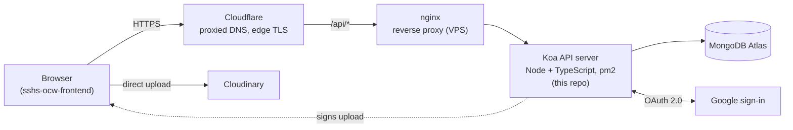
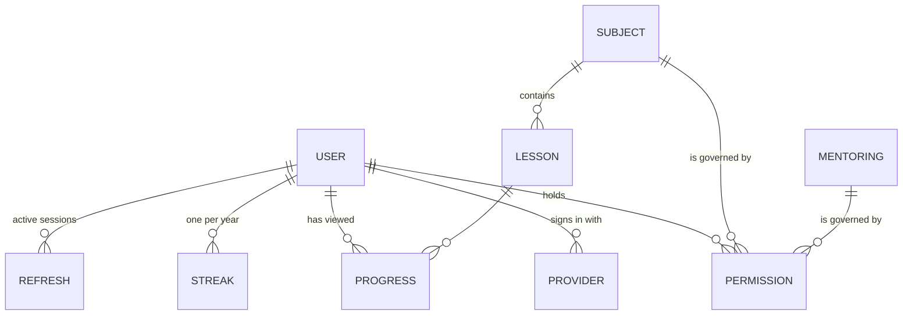

# SSHS TIPS — Backend

API server for SSHS TIPS, the Seoul Science High School Open CourseWare. 

Overview & screenshots: [frontend repo](https://github.com/danlee0677/sshs-ocw-frontend-mirror)

Demo: https://tips.sshs.app/

Built for the SSHS Student Council, shared with permission

## Summary
- **What:** The REST API behind SSHS TIPS. It handles sign-in, subjects and lessons, per-subject permissions, study progress and streaks, search, image-upload signing and the mentoring board.
- **Impact:** 270+ users, 9 subjects, 40 lessons, 20 mentorings
- **My role:** Lead developer of SSHS TIPS. I designed the architecture of both the frontend and the backend, and wrote 101 of the 146 frontend commits and 57 of the 68 backend commits. In this repo I built the data model, Google sign-in, refresh-token rotation, the owner/editor permission system, search, progress and streak tracking, and the mentoring and image-upload APIs. Teammates contributed the likes endpoints, the subject description and image fields, and the first version of lesson editing.

## Architecture



Protected routes share one pipeline: **CORS → body parser → Passport (JWT) → Zod validation → permission check → Mongoose**. The few public routes (sign-in start, token refresh, username check, subject list) skip the JWT step. In production, requests reach the server through Cloudflare (proxied DNS) and then nginx on the VPS. Koa runs with `app.proxy = true`, so it reads the client's IP and the original HTTPS scheme from the forwarded headers those proxies set.

## Stack
| Layer | Technology | Why this choice |
|---|---|---|
| Runtime / framework | Node, TypeScript 5.9, Koa 3, @koa/router | A small middleware core with native async/await; the whole request pipeline is visible in one file ([src/index.ts](src/index.ts)) |
| Database | MongoDB Atlas, Mongoose 8 | Lessons are document-shaped rich text; a managed cluster means no database server to maintain |
| Auth | Passport (Google OAuth 2.0), JWT access and refresh tokens | Stateless 15-minute access tokens; refresh tokens are stored server-side so they can be revoked |
| Validation | Zod 4 | Every request body and query is parsed before use, in the same style the frontend uses for responses |
| Abuse protection | koa-ratelimit, CORS allowlist | Limits image-upload signing per user; production only accepts the real frontend origin |
| Images | Cloudinary (signed uploads) | Files go straight from the browser to Cloudinary and never pass through this server |
| Server / hosting | Ubuntu 24.04 on a Vultr VPS (2 vCPUs, 4 GB RAM), nginx, pm2, behind Cloudflare | Cloudflare provides edge HTTPS and filters traffic before it reaches the VPS; nginx forwards to the Node process; pm2 handles restarts and logs |

## Data model



- **User**: username, profile picture, global `roles[]`, liked subjects, achievements.
- **Provider**: links an OAuth identity (provider and provider ID) to a User. Keeping it out of the User document means a second provider could be linked later without a schema change.
- **Subject / Lesson**: lessons are ordered within a subject and can be marked `student_only`. Subjects have tags, likes and a `teacher_certified` flag.
- **Permission**: `{ userId, subjectId, role: owner | editor }`, unique per (user, subject). Mentoring posts reuse the same collection, with the post's id in `subjectId`.
- **Progress / Streak**: which lessons a user viewed and when, plus a yearly activity record for the heatmap.
- **Refresh**: issued refresh tokens, used for rotation and reuse detection. Expired tokens are deleted automatically by a TTL index.
- *Module / Exercise*: reserved for practice problems. Exercise is unused; Module is referenced only by the subject-delete cleanup.

Lessons have no draft/review/publish pipeline. Trust works in layers instead:

| Mechanism | Who controls it | Effect |
|---|---|---|
| Subject `owner` | Given automatically to whoever creates the subject (admins excepted, since they already have full access) | Edits or deletes the subject, adds or removes editors, transfers ownership |
| Subject `editor` | Granted by the owner or an admin | Edits the subject and creates, edits and deletes its lessons. Can also delete the subject, since one `canEditSubject` check guards both |
| `teacher_certified` | Admins only | A trust badge, and a filter in search |
| `student_only` lesson | The subject's editors | Visible only to SSHS accounts (`@sshs.hs.kr`), admins, and the subject's owner or editors. Everyone else gets a count of hidden lessons instead. Search results apply only the SSHS/admin test |

## API overview
39 endpoints in total. The main ones are below; the full list is in the `src/**/*Router.ts` files.

| Method | Endpoint | Purpose | Who can call it |
|---|---|---|---|
| GET | `/api/auth/login/google` | Start Google sign-in (the desired username travels in a signed `state`) | Public |
| POST | `/api/auth/refresh` | Rotate the refresh token and get a new access token | Holder of a refresh cookie |
| GET | `/api/auth/verify` | Return the current user from the access token | Signed-in (Bearer token) |
| POST | `/api/auth/logout` | Sign out everywhere (deletes all of the user's refresh tokens) | Signed-in |
| GET | `/api/subjects` | List all subjects | Public |
| GET | `/api/subjects/:id` | Subject with its lesson list (student-only lessons filtered) | Signed-in |
| POST | `/api/subjects` | Create a subject (the creator becomes owner) | Creator, Admin |
| PATCH / DELETE | `/api/subjects/:id` | Edit or delete a subject (`teacher_certified` is admin-only) | Owner, Editor, Admin |
| POST | `/api/subjects/:id/like` | Toggle a like | Signed-in |
| GET | `/api/lessons/:id` | Read a lesson (student-only check applies) | Signed-in |
| POST / PATCH / DELETE | `/api/lessons[/:id]` | Write lessons | Owner, Editor, Admin |
| GET | `/api/permission/check/:subjectId` | "Can I edit this?" for the UI | Signed-in |
| POST / DELETE | `/api/permission[/:id]` | Add or remove an editor | Owner, Admin |
| PATCH | `/api/permission/:subjectId` | Transfer ownership | Owner, Admin |
| PATCH | `/api/user/:userId/roles` | Grant or revoke the `creator` role | Admin |
| POST | `/api/search` | Keyword and tag search over subjects and lessons | Signed-in |
| GET | `/api/progress/:userId/recent-subjects` | Recently studied subjects | Signed-in (own data only) |
| GET | `/api/streak/:userId` | Activity heatmap data | Signed-in |
| GET / POST / PATCH | `/api/mentoring[/:id]` | Offline mentoring board | Read: signed-in · Create: Creator, Admin · Edit: post's owner/editor, Admin |
| GET | `/api/image/sign-upload` | Signature for a direct Cloudinary upload (rate-limited) | Signed-in |

## Auth and permissions
**Login**
1. The frontend sends the user to `/api/auth/login/google?username=…`. The chosen username is wrapped in a JWT-signed OAuth `state`, so it cannot be tampered with on the round trip.
2. Google redirects back to the callback. On first login the server creates a User and a Provider record.
3. The server issues an **18-day refresh token** in an httpOnly cookie (`Secure` and `SameSite=None` in production), stores a record of it in MongoDB, and redirects to the app. The frontend then calls `/api/auth/refresh`, which returns a **15-minute access token** in the response body. The frontend keeps it in memory only.

**Refresh-token rotation**
- Each refresh token works **once**. Using it marks it as used and issues a replacement.
- **Race handling:** a page often fires several requests at the same moment, so several refreshes can arrive together. For 15 seconds after a token is used, a repeated refresh waits for the replacement and receives that same token instead of failing.
- **Reuse detection:** if a used token reappears after the grace window, it may have been stolen. The server then **deletes every session for that user** and rejects the request. A used record's expiry is cut to 15 s after use and the TTL index then removes it, so this covers replays within roughly the next minute; a later replay simply gets a 401.

**Enforcement.** The frontend only hides buttons; the server makes every decision. Subject, lesson and mentoring edit routes call `canEditSubject()` (admin, or an owner/editor record). Granting or revoking editors and transferring ownership require the owner or an admin. Reading lessons goes through `canViewStudentOnly()`. Creating a subject or mentoring post checks for the `creator` or `admin` role. Ownership transfer runs inside a **MongoDB transaction**, so two simultaneous transfers cannot both succeed.

## Infrastructure and deployment
| | |
|---|---|
| Server / OS | Ubuntu 24.04 on a Vultr VPS (2 vCPUs, 4 GB RAM) |
| Reverse proxy / TLS | Cloudflare (proxied DNS, HTTPS at the edge) → nginx on the VPS → Koa |
| Process manager | pm2 (`npm start` → `pm2 start dist/index.js --name sshs-ocw-backend`) |
| Database | MongoDB Atlas (managed) |
| Domain | tips.sshs.app (site and /api/* on the same domain) |

Deploying (edit to match the real process):
```bash
git pull
npm ci
npm run build              # tsc → dist/
pm2 restart sshs-ocw-backend
```

## Technical highlights
- **One-time refresh tokens with rotation**: includes a 15-second grace window for concurrent refreshes, and revokes every session when a used token is replayed shortly after that window.
- **Self-cleaning session store**: a TTL index deletes expired refresh tokens; nothing has to run on a schedule.
- **Race-safe ownership transfer**: the permission check and the transfer happen in one MongoDB transaction.
- **Server-side student-only access**: hidden lessons are filtered in the query, and the response carries the hidden count so the UI can show it honestly.
- **Every request body is validated with Zod**: malformed bodies get a 400 before they reach the database. Route ids are checked with `isValidObjectId`.
- **Abuse limits**: image-upload signing is limited to 10 per minute per user (admins exempt), and in production CORS accepts only the real frontend origin.
- **Multi-provider-ready identity**: OAuth identities live in a separate Provider collection, so adding Kakao or Naver login doesn't change the User model. Both strategies are already written.

## Project structure
```
src/
├── index.ts          # app setup: DB connection, CORS, Passport, router mounting
├── passport/         # OAuth strategies (Google; Kakao/Naver ready), JWT strategy, auth routes
├── refresh/          # refresh-token model, signing and cookie helpers (rotation lives in passport/authRouter.ts)
├── user/             # user model and profile routes
├── permission/       # per-subject roles, canEditSubject(), global role grants
├── lecture/          # subjects, lessons (+ reserved module/exercise models)
├── progress/         # lesson-view history, recent subjects
├── streak/           # yearly activity heatmap
├── search/           # keyword/tag search
├── mentoring/        # offline mentoring board
├── cloudinary/       # signed upload endpoint + rate limit
└── types/            # Koa context and user typings
```

---
## Appendix

### Running locally
Requires Node 20+ and a MongoDB deployment that supports transactions (Atlas, or a local replica set).

```bash
npm install
# create .env (see below)
npx tsx src/index.ts            # development
npm run build && npm start      # production build, run under pm2
```

`.env` template (placeholders only; never commit real values):
```ini
PORT=3001
MONGODB_URI=<your MongoDB connection string>

GOOGLE_CLIENT_ID=<google oauth id>
GOOGLE_CLIENT_SECRET=<google oauth secret>
# required at startup: both strategies are constructed when the server boots
KAKAO_CLIENT_ID=<kakao oauth id>
KAKAO_CLIENT_SECRET=<kakao oauth secret>
NAVER_CLIENT_ID=<naver oauth id>
NAVER_CLIENT_SECRET=<naver oauth secret>

JWT_SECRET=<random string>
REFRESH_JWT_SECRET=<different random string>
STATE_SECRET=<different random string>
JWT_ALGORITHM=HS256

BASE_API_URL=http://localhost:3001
FRONTEND_URL=http://localhost:3000
NODE_ENV=dev                    # "production" enables Secure cookies and the strict CORS allowlist

CLOUDINARY_CLOUD_NAME=<cloud name>
CLOUDINARY_API_KEY=<api key>
CLOUDINARY_API_SECRET=<api secret>
```

OAuth and Cloudinary credentials come from the [Google](https://console.cloud.google.com/auth/clients), [Kakao](https://developers.kakao.com/console/app) and [Naver](https://developers.naver.com/apps/#/register) developer consoles and from [Cloudinary](https://cloudinary.com/).

### Credits
Built with the SSHS Student Council development team.
- **danlee0677**: Lead developer. Server setup and data model, Google OAuth login, refresh-token rotation, permission system, subjects/lessons API, search, progress and streak tracking, mentoring and image-upload APIs, build/start (pm2) scripts.
- **gdquail**: Subject likes and liked-subjects endpoints, subject description and image fields, user lookup endpoint, first version of lesson editing, achievement field on users.
- **edward0613**: Mentoring list ordered by creation date.
